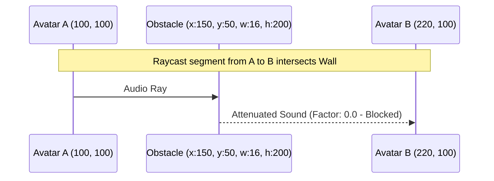
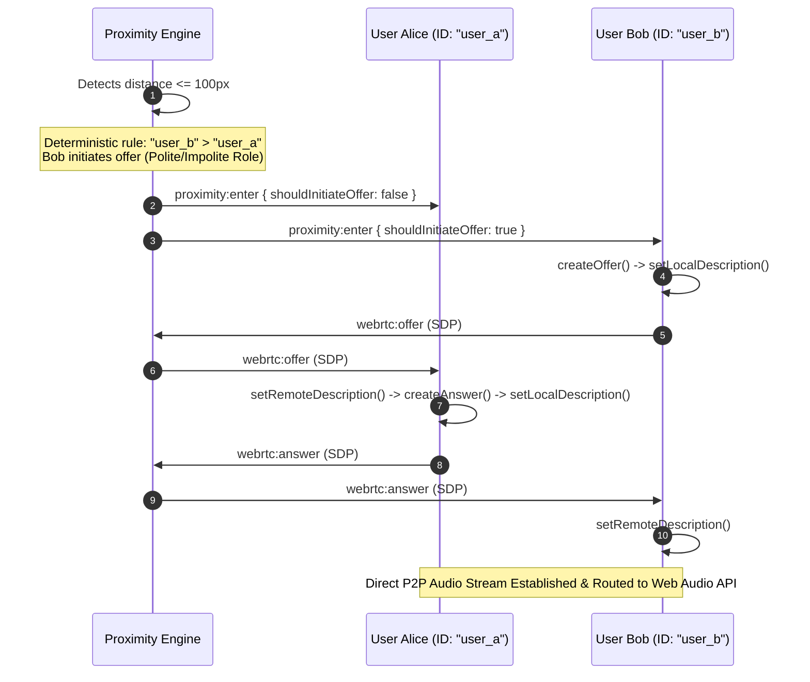

# ProxiSpeak – Geospatial Proximity Audio Ecosystem
## System Architecture & Engineering Specifications

### 1. High-Level Architecture

ProxiSpeak is structured as a decoupled full-stack real-time collaboration platform:

```mermaid
graph TD
    subgraph Client [Browser Client (React + Canvas + Web Audio)]
        UI[React UI & Controls]
        Canvas[HTML5 Canvas 60 FPS Render Loop]
        SpatialAudio[Spatial Audio Engine (Web Audio API)]
        WebRTC[WebRTC Peer Manager]
        SocketClient[Socket.io Client]
    end

    subgraph Server [Backend System (Node.js + Express + Socket.io)]
        Express[Express REST API]
        SocketServer[Socket.io Signaling Server]
        Proximity[2D Planar Spatial Grid Engine]
        Geometry[Obstacle Ray-Casting & Line-of-Sight]
    end

    subgraph Storage [Persistence & Scaling Layer]
        MongoDB[(MongoDB - Persistent Layouts & 2D Index)]
        Redis[(Redis - Pub/Sub Adapter & Multi-Instance)]
    end

    UI --> Canvas
    Canvas --> SocketClient
    WebRTC <-->|P2P Audio Stream| SpatialAudio
    SocketClient <-->|Signaling & Movement| SocketServer
    SocketServer <--> Proximity
    Proximity <--> Geometry
    Express <--> MongoDB
    SocketServer <--> Redis
```

---

### 2. Proximity & Spatial Audio Mathematics

#### 2.1 2D Cartesian Coordinate Representation
Unlike geographic maps using spherical degrees (Latitude/Longitude), ProxiSpeak represents virtual offices as a **2D Euclidean Cartesian plane** measured in pixels $(x, y)$.

The exact Euclidean distance between avatar $P_1 = (x_1, y_1)$ and $P_2 = (x_2, y_2)$ is:

$$d = \sqrt{(x_1 - x_2)^2 + (y_1 - y_2)^2}$$

#### 2.2 Dual-Radius Hysteresis
To prevent rapid connection flapping and WebRTC negotiation churn near the boundary, the engine implements dual-threshold hysteresis:
- **Entry Radius ($R_{\text{enter}} = 100\text{px}$)**: A peer enters voice proximity when distance $d \le 100\text{px}$.
- **Exit Radius ($R_{\text{exit}} = 120\text{px}$)**: An established proximity relationship is maintained until distance $d > 120\text{px}$.

#### 2.3 Distance Volume Attenuation
ProxiSpeak applies continuous linear attenuation with smooth AudioParam ramps:
- At distance $0\text{px} \rightarrow \text{Gain} = 1.0$ (100% volume)
- At distance $50\text{px} \rightarrow \text{Gain} = 0.5$ (50% volume)
- At distance $\ge 120\text{px} \rightarrow \text{Gain} = 0.0$ (Muted)

$$G_{\text{distance}} = \max\left(0, 1.0 - \frac{d}{R_{\text{exit}}}\right)$$

#### 2.4 2D Stereo Panning
Relative horizontal displacement produces stereo channel balance via `StereoPannerNode`:

$$\Delta x = x_{\text{remote}} - x_{\text{local}}$$
$$\text{pan} = \text{clamp}\left(\frac{\Delta x}{R_{\text{exit}}}, -1.0, 1.0\right)$$

- $\text{pan} = -1.0$: Full left ear
- $\text{pan} = 0.0$: Centered
- $\text{pan} = +1.0$: Full right ear

---

### 3. Acoustic Sound Blocking & Obstacle Ray-Casting

Sound attenuation is calculated geometrically using line-segment vs axis-aligned bounding box (AABB) intersection.



Combined attenuation:
$$G_{\text{final}} = G_{\text{distance}} \times \prod_{i \in \text{intersecting obstacles}} (1.0 - \text{attenuationFactor}_i)$$

- **Concrete Wall** ($\text{factor} = 1.0$): Multiplier is $0.0$ (100% soundproof).
- **Acoustic Glass** ($\text{factor} = 0.65$): Multiplier is $0.35$ (muffles voice by 65%).

---

### 4. Deterministic WebRTC Polite/Impolite Offer Negotiation

To prevent offer collision glare without an SFU, ProxiSpeak utilizes deterministic alphabetical role assignment:



---

### 5. Web Audio API Processing Chain

```
Remote WebRTC Audio Stream
          │
          ▼
┌──────────────────────────────┐
│  MediaStreamAudioSourceNode  │
└──────────────┬───────────────┘
               │
               ▼
┌──────────────────────────────┐
│          GainNode            │  <-- Smooth Linear Ramps (Distance + Walls)
└──────────────┬───────────────┘
               │
               ▼
┌──────────────────────────────┐
│       StereoPannerNode       │  <-- Real-time Pan [-1.0 to 1.0]
└──────────────┬───────────────┘
               │
               ▼
┌──────────────────────────────┐
│    AudioContext.destination  │
└──────────────────────────────┘
```

---

### 6. Mesh Topology vs SFU Migration Roadmap

#### 6.1 Current Mesh Optimization
In a traditional full-mesh topology, $N$ users establish $\frac{N(N-1)}{2}$ connections. For $N=50$, this would require $1,225$ peer connections, which degrades client CPU and bandwidth.

**ProxiSpeak's Proximity Optimization:**
Connections are **strictly proximity-bounded**. Users only establish WebRTC peer connections with avatars within $100\text{px}$. In a 50-user office, an avatar typically interacts with 2 to 6 colleagues simultaneously, reducing client WebRTC connections to a lightweight $O(k)$ where $k \ll N$.

#### 6.2 Selective Forwarding Unit (SFU) Migration Path
For enterprise scale (>200 concurrent users per room):
1. **Transport Layer**: Introduce a mediasoup or LiveKit SFU cluster.
2. **Client Audio Uplink**: Client publishes a single upstream audio track to the SFU server.
3. **Selective Downlink**: The SFU server receives spatial updates from the proximity engine and selectively forwards only the audio packets of avatars within each user's proximity radius.
4. **Zero Client Mesh Overhead**: Client receives $k$ incoming RTP streams without managing individual peer offers, answers, or ICE negotiations.
